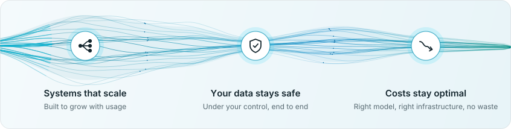
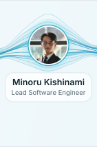
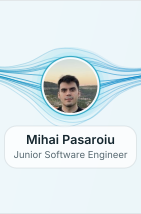
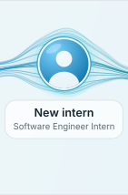
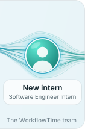

<!-- Generated by .wt/render.mjs from profile.json. Edit profile.json, not this file. -->

<a href="https://workflowtime.com"><picture><source media="(prefers-color-scheme: dark)" srcset="https://raw.githubusercontent.com/eduardragea/eduardragea/output/social-site-dark.svg"></picture></a>
<a href="https://www.linkedin.com/in/eduard-ragea/"><picture><source media="(prefers-color-scheme: dark)" srcset="https://raw.githubusercontent.com/eduardragea/eduardragea/output/social-linkedin-dark.svg"></picture></a>
<a href="https://www.instagram.com/workflowtime/"><picture><source media="(prefers-color-scheme: dark)" srcset="https://raw.githubusercontent.com/eduardragea/eduardragea/output/social-instagram-dark.svg"></picture></a>

<picture><source media="(prefers-reduced-motion: reduce) and (prefers-color-scheme: dark)" srcset="https://raw.githubusercontent.com/eduardragea/eduardragea/output/hero-dark-still.svg"><source media="(prefers-reduced-motion: reduce)" srcset="https://raw.githubusercontent.com/eduardragea/eduardragea/output/hero-light-still.svg"><source media="(prefers-color-scheme: dark)" srcset="https://raw.githubusercontent.com/eduardragea/eduardragea/output/hero-dark.svg"></picture>

## Hey, I'm Eduard 👋

<small>I'm co-founder and CTO of [WorkflowTime](https://workflowtime.com). I build AI systems that scale, keep your data safe and keep costs optimal, and I lead the teams building them.</small>

<small>We do research as well, so what we ship is based on what actually works today.</small>

<picture><source media="(prefers-reduced-motion: reduce) and (prefers-color-scheme: dark)" srcset="https://raw.githubusercontent.com/eduardragea/eduardragea/output/pillars-dark-still.svg"><source media="(prefers-reduced-motion: reduce)" srcset="https://raw.githubusercontent.com/eduardragea/eduardragea/output/pillars-light-still.svg"><source media="(prefers-color-scheme: dark)" srcset="https://raw.githubusercontent.com/eduardragea/eduardragea/output/pillars-dark.svg"></picture>

#### Experience

- <small>Co-founder & CTO @ [WorkflowTime](https://workflowtime.com) (50+ case studies, 50K+ hours saved, €1M+ in cost savings)</small>

#### What we build

- <small>AI systems and agents for freight logistics, insolvency law, EU funds, public tenders and venture capital</small>
- <small>Mobile apps for beauty commerce, film streaming and a cleaning services marketplace, plus our own consumer apps</small>
- <small>Platforms for wholesale (ERP with e-invoicing), sports events (e-commerce and POS), hotels and warehouses</small>
- <small>Automation for dental clinics, solar lead routing, payroll and HR, restaurant marketing and news publishing</small>

<picture><source media="(prefers-reduced-motion: reduce) and (prefers-color-scheme: dark)" srcset="https://raw.githubusercontent.com/eduardragea/eduardragea/output/marquee-dark-still.svg"><source media="(prefers-reduced-motion: reduce)" srcset="https://raw.githubusercontent.com/eduardragea/eduardragea/output/marquee-light-still.svg"><source media="(prefers-color-scheme: dark)" srcset="https://raw.githubusercontent.com/eduardragea/eduardragea/output/marquee-dark.svg"></picture>

<a href="https://cal.com/workflow-time/30min"><picture><source media="(prefers-reduced-motion: reduce) and (prefers-color-scheme: dark)" srcset="https://raw.githubusercontent.com/eduardragea/eduardragea/output/cta-dark-still.svg"><source media="(prefers-reduced-motion: reduce)" srcset="https://raw.githubusercontent.com/eduardragea/eduardragea/output/cta-light-still.svg"><source media="(prefers-color-scheme: dark)" srcset="https://raw.githubusercontent.com/eduardragea/eduardragea/output/cta-dark.svg"></picture></a>

<a href="https://www.linkedin.com/in/marioghenea/"><picture><source media="(prefers-reduced-motion: reduce) and (prefers-color-scheme: dark)" srcset="https://raw.githubusercontent.com/eduardragea/eduardragea/output/team-1-dark-still.svg"><source media="(prefers-reduced-motion: reduce)" srcset="https://raw.githubusercontent.com/eduardragea/eduardragea/output/team-1-light-still.svg"><source media="(prefers-color-scheme: dark)" srcset="https://raw.githubusercontent.com/eduardragea/eduardragea/output/team-1-dark.svg"></picture></a><a href="https://github.com/eduardragea"><picture><source media="(prefers-reduced-motion: reduce) and (prefers-color-scheme: dark)" srcset="https://raw.githubusercontent.com/eduardragea/eduardragea/output/team-2-dark-still.svg"><source media="(prefers-reduced-motion: reduce)" srcset="https://raw.githubusercontent.com/eduardragea/eduardragea/output/team-2-light-still.svg"><source media="(prefers-color-scheme: dark)" srcset="https://raw.githubusercontent.com/eduardragea/eduardragea/output/team-2-dark.svg"></picture></a><a href="https://github.com/MinoruKi"><picture><source media="(prefers-reduced-motion: reduce) and (prefers-color-scheme: dark)" srcset="https://raw.githubusercontent.com/eduardragea/eduardragea/output/team-3-dark-still.svg"><source media="(prefers-reduced-motion: reduce)" srcset="https://raw.githubusercontent.com/eduardragea/eduardragea/output/team-3-light-still.svg"><source media="(prefers-color-scheme: dark)" srcset="https://raw.githubusercontent.com/eduardragea/eduardragea/output/team-3-dark.svg"></picture></a><a href="https://github.com/12mihai05"><picture><source media="(prefers-reduced-motion: reduce) and (prefers-color-scheme: dark)" srcset="https://raw.githubusercontent.com/eduardragea/eduardragea/output/team-4-dark-still.svg"><source media="(prefers-reduced-motion: reduce)" srcset="https://raw.githubusercontent.com/eduardragea/eduardragea/output/team-4-light-still.svg"><source media="(prefers-color-scheme: dark)" srcset="https://raw.githubusercontent.com/eduardragea/eduardragea/output/team-4-dark.svg"></picture></a><a href="https://workflowtime.com/#/team"><picture><source media="(prefers-reduced-motion: reduce) and (prefers-color-scheme: dark)" srcset="https://raw.githubusercontent.com/eduardragea/eduardragea/output/team-5-dark-still.svg"><source media="(prefers-reduced-motion: reduce)" srcset="https://raw.githubusercontent.com/eduardragea/eduardragea/output/team-5-light-still.svg"><source media="(prefers-color-scheme: dark)" srcset="https://raw.githubusercontent.com/eduardragea/eduardragea/output/team-5-dark.svg"></picture></a><a href="https://workflowtime.com/#/team"><picture><source media="(prefers-reduced-motion: reduce) and (prefers-color-scheme: dark)" srcset="https://raw.githubusercontent.com/eduardragea/eduardragea/output/team-6-dark-still.svg"><source media="(prefers-reduced-motion: reduce)" srcset="https://raw.githubusercontent.com/eduardragea/eduardragea/output/team-6-light-still.svg"><source media="(prefers-color-scheme: dark)" srcset="https://raw.githubusercontent.com/eduardragea/eduardragea/output/team-6-dark.svg"></picture></a>

